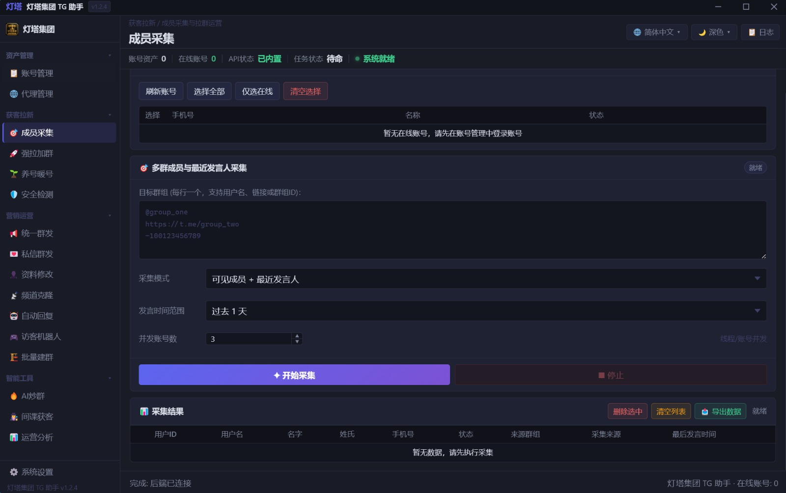
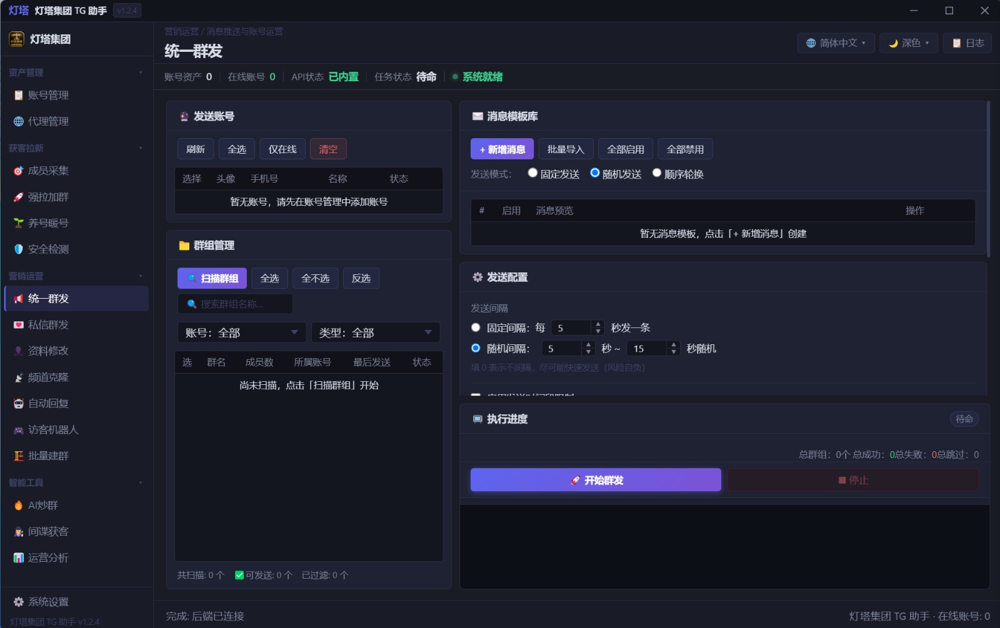
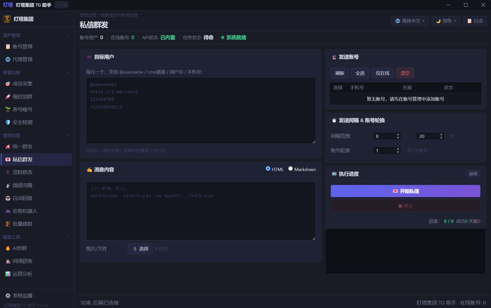
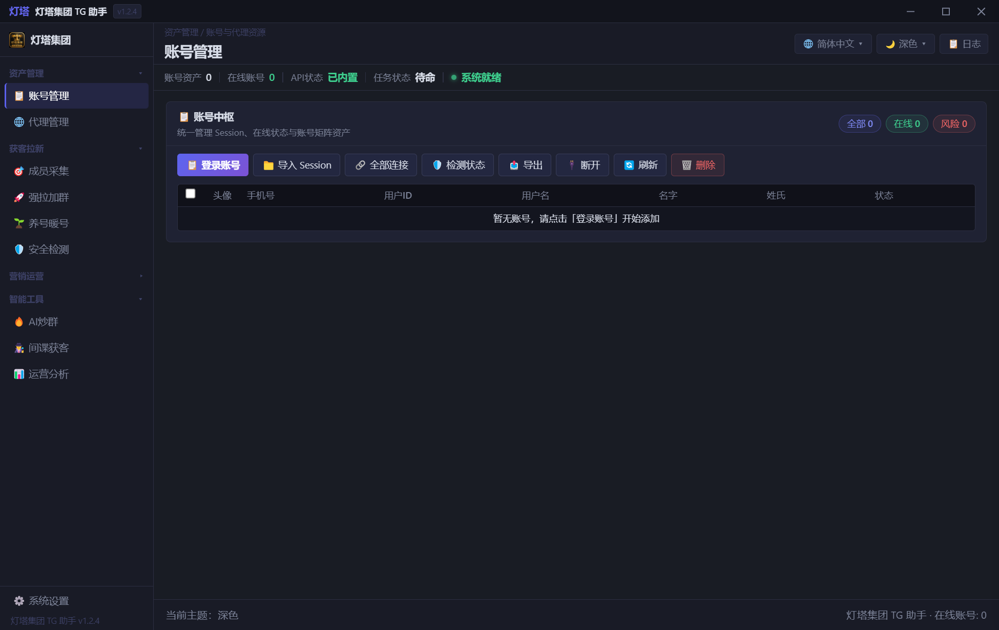
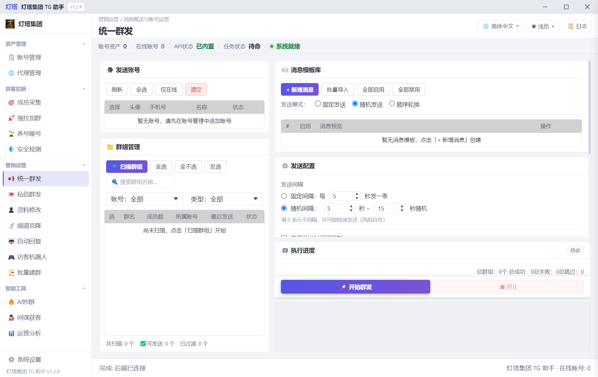

# 灯塔集团 Telegram 营销助手

多账号管理、群组运营与增长的 Windows 桌面工具。界面简洁，支持深色 / 浅色 / 跟随系统主题。

> 🧪 当前为 **免费公测版**，欢迎试用并反馈问题。后续正式版可能引入激活码。

## 界面预览

深色主题 · 成员采集页

深色主题 · 统一群发页

深色主题 · 私信群发页

深色主题 · 账号管理页

浅色主题 · 统一群发页

## 下载

- GitHub：[最新版本 Releases](../../releases/latest)
- 官方下载页（国内访问更快）：https://tg.amaban.app:8092

系统要求：Windows 10 / 11（64 位）
安装包文件名：`TG.Setup.X.Y.Z.exe`（GitHub Releases 附件名；官方下载页上显示的是中文原名）

> 安装时若提示"未知发布者"：点击「更多信息」→「仍要运行」。

## 功能一览

**资产管理**
- 账号管理：手机号登录、导入 / 导出 Session、在线状态检测
- 代理管理：批量导入、连通性直测、分配与验证

**获客拉新**
- 成员采集 · 群组邀请 · 账号养护 · 安全检测

**营销运营**
- 统一群发 · 私信群发 · 资料修改 · 频道克隆
- 自动回复 · 访客机器人 · 批量建群

**智能工具**
- AI 炒群 · 间谍获客 · 运营分析

## 特色

- 多账号并发，内置限流保护与凭证自动切换
- 版本自动检测，有新版本时侧栏「系统设置」出现红点提示
- 深色 / 浅色主题一键切换，记住你的选择

## 快速上手

1. 安装并打开软件
2. 在「账号管理」点击「登录账号」，输入带国际区号的手机号（如 +1 2025550123、+886 912345678）
3. 建议在「代理管理」为每个账号配置独立代理
4. 进入所需功能页，按提示配置后开始任务
5. 请控制操作频率，避免触发平台限制

## 常见问题

**Q：安装时被 Windows 拦截？**
A：软件暂未购买代码签名证书，点击「更多信息」→「仍要运行」即可。

**Q：登录账号收不到验证码？**
A：请确认号码带 + 和国际区号；多次请求可能被 Telegram 限流，稍等再试。

**Q：如何更新？**
A：软件会自动检测新版本，侧栏「系统设置」出现红点时，进入「版本更新」按提示下载。

**Q：数据存在哪里？**
A：账号 Session 与配置仅保存在你本机，不会上传。

## 反馈

- GitHub Issues：[提交问题](../../issues/new/choose)（请勿上传手机号、Session、API Key、代理信息）
- Telegram：[@gdpsc](https://t.me/gdpsc)

## 免责声明

本软件仅限合法合规用途。使用者须遵守 Telegram 服务条款及所在地法律法规，因使用不当产生的一切后果由使用者自行承担。
